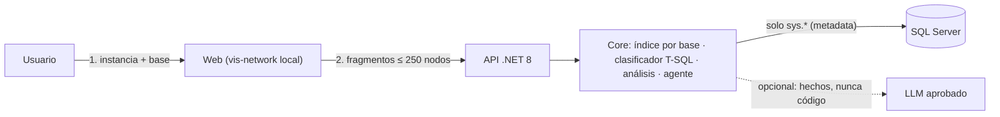

# SqlGraphCopilot

Mapa y análisis de dependencias de SQL Server (instancias, bases, SPs, tablas, vistas, funciones, triggers, sinónimos y servidores vinculados) con carga bajo demanda y un agente IA que responde **"¿qué se rompe si modifico X?"**.

Es la capa **"a nivel de SPs"** de la base común del agente del core: el motor (`SqlGraphCopilot.Core`) se empaqueta como NuGet y expone `ISqlGraphToolbox` para que otros agentes lo usen.



Detalle completo en [docs/ARQUITECTURA.md](docs/ARQUITECTURA.md).

## Estructura

```
SqlGraphCopilot/
├─ src/
│  ├─ SqlGraphCopilot.Core/      Motor (NuGet): Domain · Graph · Parsing · Metadata · Indexing · Exploration · Analysis · Agent
│  └─ SqlGraphCopilot.Api/       Minimal API + wwwroot (index.html, css, js, lib/vis-network)
├─ tests/SqlGraphCopilot.Core.Tests/   xUnit (42 pruebas) con catálogo en memoria
├─ sql/                          01 login solo lectura · 02 consultas de extracción · 03 verificación
└─ docs/ARQUITECTURA.md
```

## Puesta en marcha

**Requisitos:** .NET 8 SDK · SQL Server 2016+ (en 2014 use `ComputeDefinitionHash: false`) · acceso a una instancia de **desarrollo**.

1. **Login de solo lectura** (con un DBA): ejecutar `sql/01_login_solo_lectura.sql` y luego, conectado con ese login, `sql/03_verificacion.sql`.

2. **Configurar la instancia** en `src/SqlGraphCopilot.Api/appsettings.json` (nombre, alias de linked servers, patrones críticos) y la cadena de conexión con *user-secrets* (nunca en el JSON):

   ```bash
   cd src/SqlGraphCopilot.Api
   dotnet user-secrets set "SqlGraphCopilot:Instances:0:ConnectionString" "Server=SRVDEVCORE01;User ID=sqlgraph_reader;Password=***;TrustServerCertificate=True;Encrypt=True"
   ```

   > La aplicación no arranca si una instancia no tiene `ConnectionString` (validación al inicio).

3. **Ejecutar:**

   ```bash
   dotnet run --project src/SqlGraphCopilot.Api
   ```

   Abrir `https://localhost:7180` (Swagger en `/swagger` en Development).

4. **Pruebas:** `dotnet test`

## Uso

1. Elegir **instancia** y **base** → *Cargar red* (solo se lee el catálogo de esa base).
2. Se muestran los **hubs** (objetos más referenciados). **Doble clic** en un nodo carga sus vecinos; «＋» indica vecinos pendientes.
3. Nodos naranjas con borde punteado = **otra base o instancia**: al hacer doble clic se pide confirmación y se carga **solo esa rama**.
4. Panel **Detalle**: impacto si se modifica, expandir 1–2 niveles, usar como foco (filtro de saltos).
5. Panel **Análisis**: resumen, puntos únicos de fallo, acoplamiento, redundancias, cuellos de botella, referencias rotas.
6. Panel **Copiloto IA**: preguntas en lenguaje natural; "este" se refiere al nodo seleccionado.
7. **Escaneo profundo** (barra superior): clasifica lee/escribe/ejecuta en todos los módulos; necesario para cuellos de botella completos.

## Configuración (`SqlGraphCopilot`)

| Clave | Por defecto | Para qué |
|---|---|---|
| `Instances[].Name` | — | Nombre lógico; forma parte del Id de cada objeto |
| `Instances[].ConnectionString` | — | **user-secrets / variable de entorno** |
| `Instances[].LinkedServerAliases` | `[]` | `@@SERVERNAME` y nombres de linked server que apuntan a esta instancia (une los puentes) |
| `Instances[].AllowedDatabases` / `ExcludedDatabases` | `[]` | Lista blanca / negra de bases |
| `CriticalNamePatterns` | `[]` | Regex que marcan objetos críticos (p. ej. `Cierre`, `Saldo`) |
| `IndexCacheMinutes` | `30` | Vida del índice en memoria |
| `MaxNodesPerRequest` | `250` | Tope de nodos por respuesta |
| `MaxNeighborhoodDepth` | `4` | Máximo de saltos por expansión |
| `ComputeDefinitionHash` | `true` | Detecta SPs duplicados (SQL 2016+) |
| `AutoClassifyOnExpand` | `true` | Clasifica lee/escribe al expandir |

### LLM (opcional, `SqlGraphCopilot:Llm`)

Sin configurar, el copiloto responde con el **narrador determinista** (sin red). Con un proveedor aprobado por el banco:

```bash
# Azure OpenAI
dotnet user-secrets set "SqlGraphCopilot:Llm:Provider" "OpenAICompatible"
dotnet user-secrets set "SqlGraphCopilot:Llm:Endpoint" "https://<recurso>.openai.azure.com/openai/deployments/<deployment>/chat/completions?api-version=2024-06-01"
dotnet user-secrets set "SqlGraphCopilot:Llm:ApiKeyHeader" "api-key"
dotnet user-secrets set "SqlGraphCopilot:Llm:ApiKey" "***"

# Modelo local (Ollama), sin salida a Internet
#   Provider=OpenAICompatible · Endpoint=http://localhost:11434/v1/chat/completions · Model=<modelo>

# Claude (Anthropic)
#   Provider=Anthropic · Model=claude-sonnet-5-5 · ApiKey=***
```

El LLM recibe **solo hechos** (nombres de objetos, relaciones y métricas). Nunca definiciones SQL ni datos.

## API

| Método | Ruta | Descripción |
|---|---|---|
| GET | `/api/instances` | Instancias registradas |
| GET | `/api/instances/{i}/databases` | Bases accesibles |
| GET | `/api/instances/{i}/databases/{db}/summary` | Construye/reusa el índice y devuelve métricas |
| GET | `/api/instances/{i}/databases/{db}/objects?search=&kinds=&page=` | Búsqueda paginada |
| POST | `/api/instances/{i}/databases/{db}/refresh` | Releer catálogo |
| GET | `/api/graph/hubs?instance=&database=&top=` | Vista inicial |
| GET | `/api/graph/neighborhood?nodeId=&depth=&direction=` | Vecindario / rama externa (422 si no es alcanzable) |
| GET | `/api/analysis/impact?nodeId=&maxDepth=` | Impacto de cambios |
| GET | `/api/analysis/{overview\|spof\|coupling\|redundancy\|bottlenecks\|broken-references}?instance=&database=` | Análisis globales |
| POST | `/api/analysis/deep-scan` | Clasificación completa |
| POST | `/api/copilot/chat` | Agente en lenguaje natural |
| POST | `/api/sql/parse` | Analiza un script T-SQL |

## Como NuGet en otros proyectos

```bash
dotnet pack src/SqlGraphCopilot.Core -c Release -o ./artifacts
```

```csharp
builder.Services.AddSqlGraphCopilot(builder.Configuration);

// en un servicio del agente
public sealed class RevisionDeSp
{
    private readonly ISqlGraphToolbox _graph;
    public RevisionDeSp(ISqlGraphToolbox graph) { _graph = graph; }

    public Task<ImpactReport> ImpactoAsync(string instancia, string baseDatos, string esquema, string nombre, CancellationToken ct)
    {
        string nodeId = new ObjectKey(instancia, baseDatos, esquema, nombre).Id;
        return _graph.AnalyzeImpactAsync(nodeId, 6, ct);
    }
}
```

## Límites conocidos

- SQL dinámico y dependencias desde aplicaciones no son visibles en el catálogo (se advierte en cada análisis).
- El impacto entre bases considera solo las bases ya cargadas en memoria.
- SPs elegidos en tiempo de ejecución (p. ej. Prometeus) no se detectan estáticamente.
- Antes de usar con datos reales, validar las consultas en desarrollo con `sql/03_verificacion.sql`.
