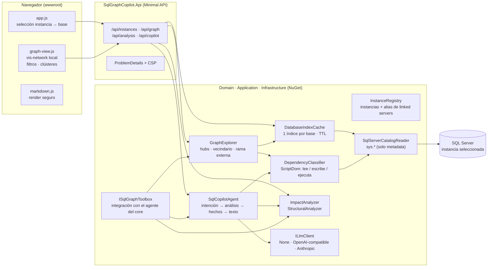
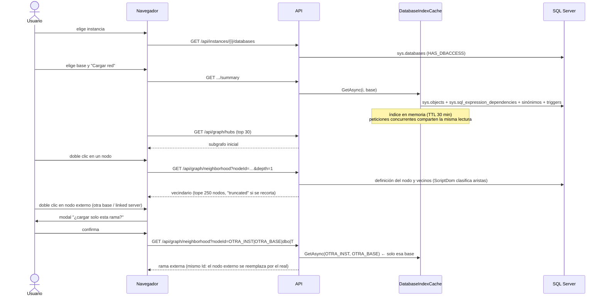
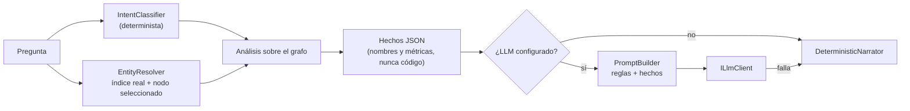
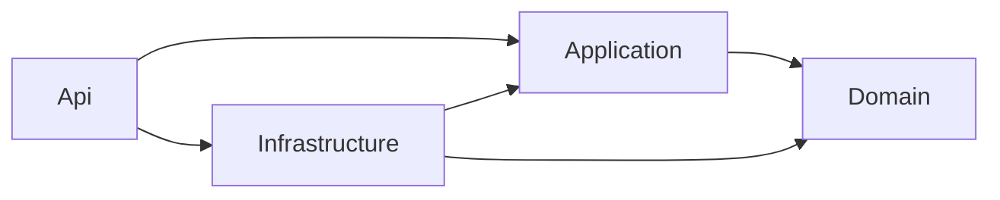

# Arquitectura — SqlGraphCopilot

## 1. Vista general

**Regla de oro:** el servidor guarda un índice *liviano* (nombres, tipos y aristas, sin código) de la base que el usuario seleccionó; al navegador solo viajan fragmentos de ≤ 250 nodos.

## 2. Flujo de carga on-demand

### Por qué no satura

| Riesgo | Mitigación |
|---|---|
| Miles de SPs | Índice solo de metadata (sin código); el cliente nunca recibe el grafo completo |
| Render del navegador | Hubs iniciales, vecindarios con tope, clústeres automáticos > 120 nodos, física se apaga > 450 nodos |
| Lecturas globales | Nada se lee hasta elegir instancia y base; otras bases solo al confirmar una rama externa |
| Parseo de miles de definiciones | Clasificación perezosa (solo lo que se expande); el escaneo profundo es opcional, en streaming y en paralelo |
| Peticiones simultáneas | `Lazy<Task>` por base: una sola lectura del catálogo aunque lleguen N peticiones |

## 3. Modelo del grafo

- **Id canónico:** `INSTANCIA|BASE|ESQUEMA|NOMBRE` en mayúsculas. La instancia es el nombre **registrado**, no `@@SERVERNAME`; los alias (`LinkedServerAliases`) traducen nombres de linked server. Por eso un nodo externo y el objeto real tienen el mismo Id y la rama se "engancha" sola.
- **Arista:** `origen → destino` = "origen depende de destino". Tipos combinables (`[Flags]`): `References` (catálogo, sin clasificar), `Reads`, `Writes`, `Executes`, `Calls`, `TriggeredBy`, `SynonymFor`.
- **Tipos de nodo:** `Table`, `View`, `StoredProcedure`, `Function`, `Trigger`, `Synonym`, `External` (otra base/instancia, no expandido), `LinkedServer` (OPENQUERY / EXEC AT), `Missing` (referencia rota).

### Fuentes y responsabilidades

| Fuente | Aporta | Autoridad |
|---|---|---|
| `sys.sql_expression_dependencies` | Qué referencia a qué (incluye 3 y 4 partes) | **Existencia** de la relación |
| ScriptDom sobre `sys.sql_modules` | Si es lectura, escritura, EXEC, SQL dinámico, OPENQUERY | **Tipo** de la relación |
| `sys.synonyms`, `sys.triggers` | Sinónimo → base, trigger → tabla | Estructura |
| `HASHBYTES('SHA2_256', definition)` | Huella para detectar duplicados | Sin exponer código |

## 4. Análisis

| Análisis | Algoritmo | Qué reporta |
|---|---|---|
| Impacto | BFS inverso con profundidad y "vía" + impacto por datos (lectores de lo que escribe) + bases ya cargadas | Afectados por nivel, críticos, puntaje 0–100 y nivel |
| Puntos únicos de fallo | Puntos de articulación (Tarjan iterativo) ∪ mayor fan-in, ponderado por dependientes totales | Objetos que arrastran a muchos |
| Acoplamiento | Fan-in, fan-out, inestabilidad `out/(in+out)` | Objetos más acoplados |
| Redundancias | Hash idéntico + Jaccard ≥ 75 % de dependencias con índice invertido | SPs duplicados o casi iguales |
| Cuellos de botella | Tablas con ≥ 2 escritores, cadenas EXEC ≥ 4 niveles, ciclos (SCC), SPs "dios", SQL dinámico | Riesgos de bloqueo y transacciones largas |
| Referencias rotas | Nodos `Missing` | Objetos que se usan pero no existen |

Los análisis globales se cachean por índice y se invalidan cuando la clasificación cambia el grafo (`DatabaseIndex.Version`).

## 5. Agente IA

- **La IA no decide qué analizar:** la intención y los objetos se resuelven de forma determinista; el LLM solo redacta sobre hechos calculados. Resultado reproducible y auditable.
- **Funciona sin LLM:** el narrador determinista es el modo por defecto, útil mientras el banco aprueba un proveedor.
- **Exposición mínima:** el LLM recibe nombres de objetos y métricas; jamás definiciones SQL (hay una prueba que lo verifica).

## 6. Integración con el agente del core

El motor (`Domain`, `Application` e `Infrastructure`) se empaqueta como NuGet (`dotnet pack`). El agente del core lo registra con `services.AddSqlGraphCopilot(configuration)` y usa `ISqlGraphToolbox` como herramienta:

| Situación en el flujo del agente | Llamada |
|---|---|
| La HU señala un SP sospechoso ("revisa este SP") | `AnalyzeImpactAsync(nodeId)` antes de proponer el cambio |
| Ubicar el objeto que menciona la incidencia | `FindObjectsAsync(instancia, base, texto)` |
| Entender el flujo alrededor de un SP | `GetNeighborhoodAsync(nodeId, 2, Both)` |
| Diagnóstico para priorizar deuda técnica | `GetOverviewAsync(instancia, base)` |

Es la evolución "a nivel de SPs" de la base común: el agente sigue sin levantar ambientes porque solo consulta metadata.

## 7. Seguridad

- Login de **solo lectura de metadata** (`VIEW ANY DEFINITION` / `VIEW DEFINITION`), sin `db_datareader` → `sql/01_login_solo_lectura.sql`.
- `ApplicationIntent=ReadOnly`; la base se fija por `InitialCatalog` (sin concatenar SQL).
- Cadenas de conexión y API keys en **user-secrets / variables de entorno / Key Vault**, nunca en `appsettings.json`.
- Errores 500 sin detalles internos (ProblemDetails); errores 4xx con mensaje accionable.
- Frontend: CSP `script-src 'self'`, sin CDN, sin `innerHTML` con datos sin escapar, sin manejadores inline.
- **Pendiente para un ambiente compartido:** autenticación (Windows/Entra ID) delante de la API.

## 8. Cambios respecto al código original

| # | Original | Problema | Ahora |
|---|---|---|---|
| 1 | `MockDataSeeder`, `MultiInstanceGraphManager` | Datos inventados mezclados con los reales en el mismo grafo | Eliminados; todo sale del catálogo |
| 2 | `GetDownstreamImpact` | Recorría todas las aristas por cada nodo (O(V·E)) | Listas de adyacencia (O(V+E)) |
| 3 | `SqlAstVisitor` (escrituras) | El destino se quitaba de lecturas y el recorrido de los hijos lo volvía a agregar | Se excluye el fragmento destino por referencia |
| 4 | `SqlAstVisitor` (alias) | `UPDATE c ... FROM dbo.Clientes c` generaba la tabla falsa `dbo.c` | Alias resuelto a la tabla real |
| 5 | `SqlAstVisitor` (CTE / #temp) | CTEs y temporales aparecían como `dbo.X` | Excluidos |
| 6 | `SqlAstVisitor` (3/4 partes) | Se perdían base y servidor: no había puentes reales | Se conservan → nodos externos |
| 7 | `TSqlParsingService` | Cualquier error de sintaxis descartaba el SP completo | Devuelve lo extraído + errores |
| 8 | `DatabaseInspectorService` | `Executes` se perdía si el SP destino se leía después | Nodos primero, aristas después |
| 9 | `/api/graph/nodes` | Devolvía nodos sin aristas; el frontend usaba aristas fijas de respaldo | Subgrafos con nodos + aristas |
| 10 | `ExtractKeyword` | Sin coincidencia devolvía `"dbo"` y coincidía con todo | Resolución contra el índice; si no hay objeto, pregunta |
| 11 | Frontend | `innerHTML` con la respuesta sin escapar (XSS); `/High/gi` alteraba nombres de objetos | Markdown seguro; textos en español desde el backend |
| 12 | Criticidad | `"Cierre"` y `"Clientes"` fijos en código | `CriticalNamePatterns` en configuración |
| 13 | `DashboardRenderer` | HTML en un string de C#, Tailwind y vis desde CDN | `wwwroot` estático, vis local, CSP |

## 9. Límites conocidos

- **SQL dinámico:** sus dependencias no existen para el catálogo. Se marca el objeto y se advierte en cada análisis.
- **Dependencias desde aplicaciones** (.NET, reportes, jobs del Agent) no están en `sys.*`.
- **Impacto entre bases:** solo cuenta bases ya cargadas en memoria; el reporte lista cuáles se revisaron.
- **Módulos cifrados** (`WITH ENCRYPTION`): se ven en el catálogo, pero no se pueden clasificar.
- **SPs elegidos en tiempo de ejecución** (p. ej. Prometeus) no se ven en el análisis estático.
- **Validación:** el motor está probado con un catálogo en memoria y con el parser real de ScriptDom; las consultas `sys.*` deben validarse en una instancia de desarrollo con `sql/03_verificacion.sql`.

## Capas y dependencias entre proyectos

El motor sigue Clean Architecture: las dependencias apuntan hacia adentro.

| Proyecto | Contiene | Referencia a |
|---|---|---|
| **Domain** | `GraphNode`, `ObjectKey`, `DependencyGraph`, `DatabaseIndex`, excepciones | nada |
| **Application** | Agente, análisis de impacto, explorador, flujo de SP, `DatabaseIndexBuilder/Cache`, `DependencyClassifier`, `LlmResponseCache`, `UsageContext`, opciones y **puertos** | Domain |
| **Infrastructure** | `SqlServerCatalogReader`, `InstanceRegistry`, `TSqlParsingService` y analizador de flujo (ScriptDom), clientes LLM, `UsageTracker` (archivo .jsonl), `MigrationVerifier` (`dotnet test`) | Application, Domain |
| **Api** | Endpoints, contratos, login, ProblemDetails/CSP; *composition root* | Application, Infrastructure |

Puertos definidos en Application (`Abstractions/`): `ICatalogReader`, `IInstanceRegistry`, `ITSqlParsingService`, `ILlmClient`,
`IProcedureFlowAnalyzer`, `IMigrationVerifier`, `IUsageTracker`.

Registro de servicios: `AddApplication()` (casos de uso, caché del LLM, flujo) y `AddInfrastructure(configuration)`
(implementaciones de los puertos y las secciones de configuración `SqlGraphCopilot`, `SqlGraphCopilot:Llm`, `LlmCache`, `Usage`, `MigrationVerifier`).
`AddSqlGraphCopilot(configuration)` llama a ambos y se conserva para los consumidores del NuGet.
